**********************
Examples
**********************

MultiX features four couplers: one for large deformation, contact, and damage in fluid–solid and solid–solid problems; one for multiphase, multicomponent heat–fluid–solid interactions; one for assembly; and one for multiscale material properties.

To run MultiX: ::

  cd FENGSim/toolkit/MultiX/build
  ./multix

========================
Extreme Mechanics
========================

-------------------------
ALE
-------------------------

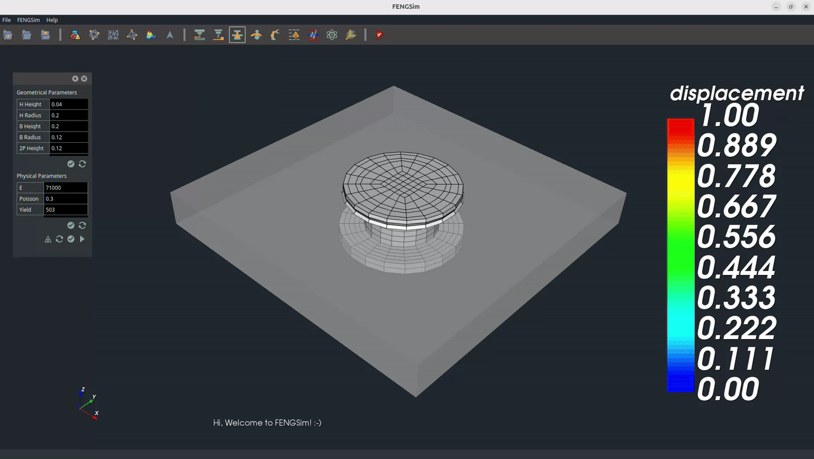

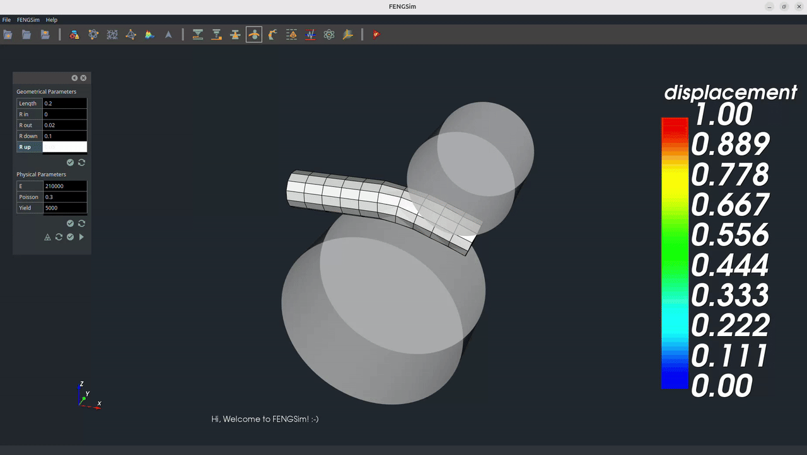
	   
.. image:: fig/ale.gif
   :width: 100%
   :alt: alternate text
   :align: center

-------------------------
MPM
-------------------------

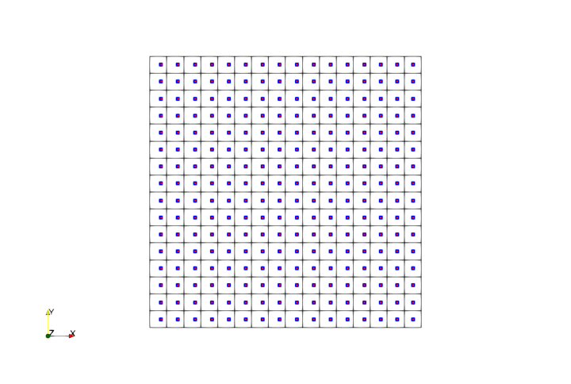

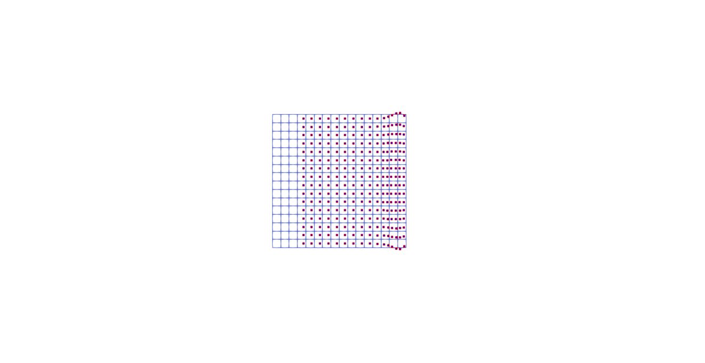

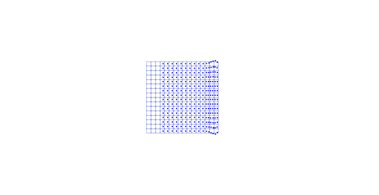

=============================
Complex Assembled Structure
=============================

------------------------------
Assembly and Modal Analysis
------------------------------

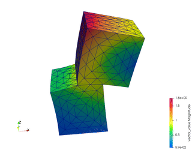

|
|

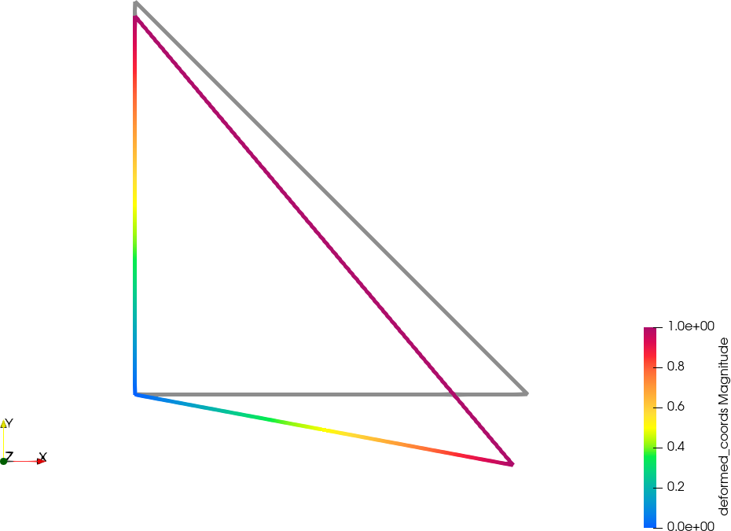

---------------------------------------------------------
Prestress Induced by Electrodynamic and Thermal Effects
---------------------------------------------------------

To run the example: ::

  cd FENGSim/starter/multix/
  ./run
  paraview data/vtk/magnetostatics_nonlinear_domain.vtk

.. image:: fig/static_mag.png
   :width: 50%
   :alt: alternate text
   :align: center

--------------------------
Mutibody
--------------------------

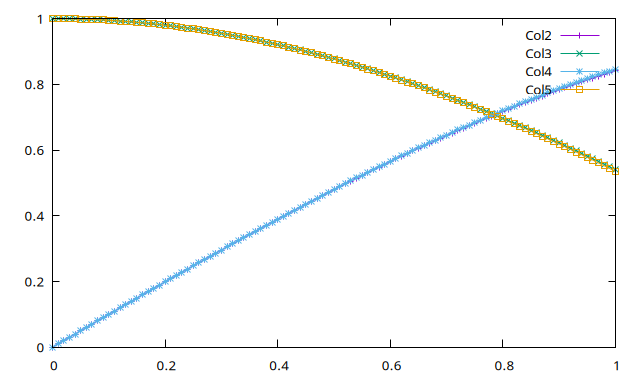
	   
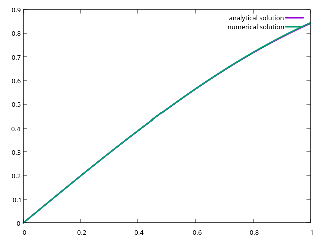

--------------------------
Reinforcement Learning
--------------------------

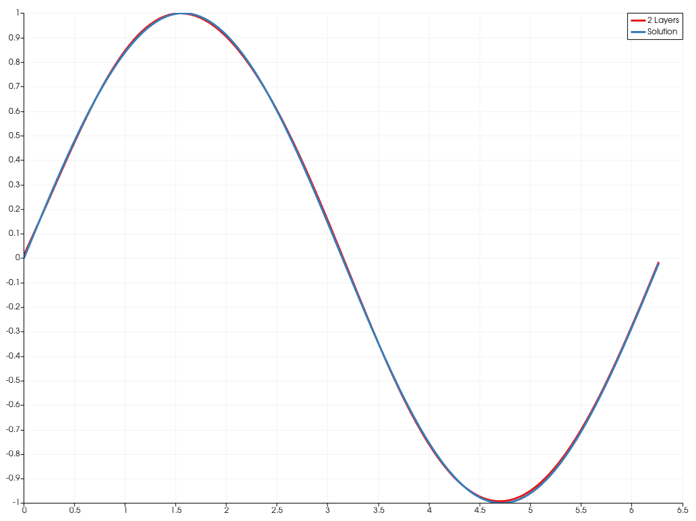

|
|

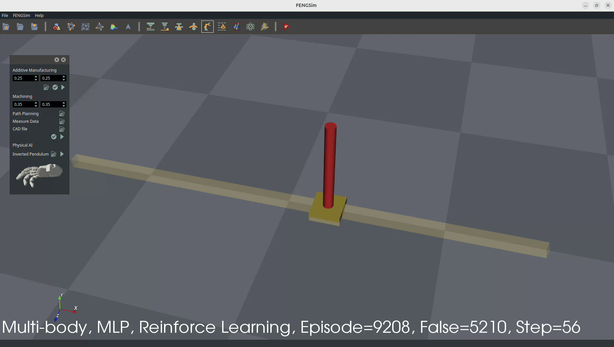
	   
==============================================================
Multi-Phase, Multi-Component Thermo-Hydro-Mechanical Systems
==============================================================

--------------------------
Multi-Phase
--------------------------

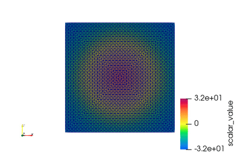

--------------------------
Multi-Component
--------------------------

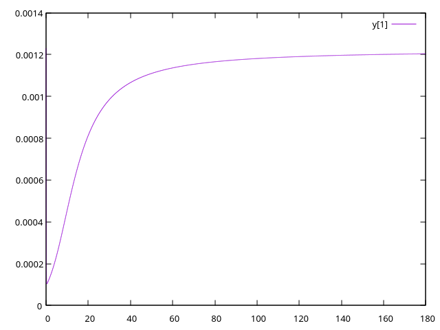

------------------------------------------
Imcompressible Navier-Stokes equations
------------------------------------------

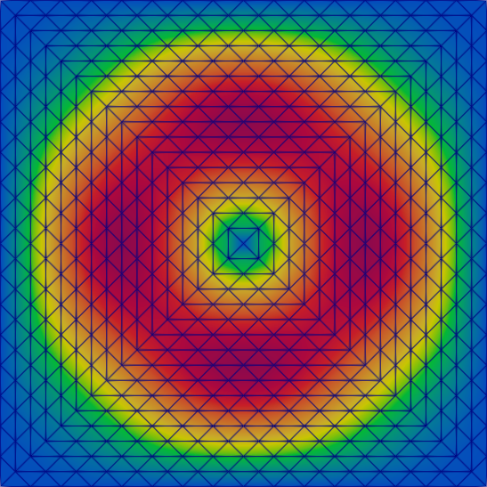

------------------------------------------
Compressible Navier-Stokes equations
------------------------------------------
	   
======================================================================================================================================================
Multiscale Modeling of Multifunctional Material Properties
======================================================================================================================================================

--------------------------
Mechanical Performance
--------------------------

--------------------------
Electromagnetic Response
--------------------------

-----------------------------
Radiation Energy Deposition
-----------------------------
